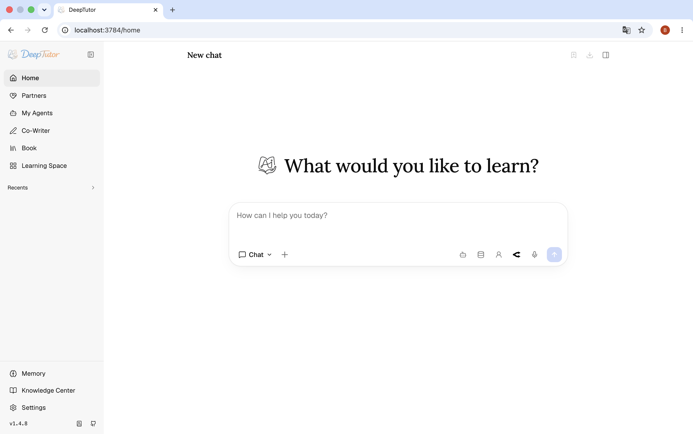
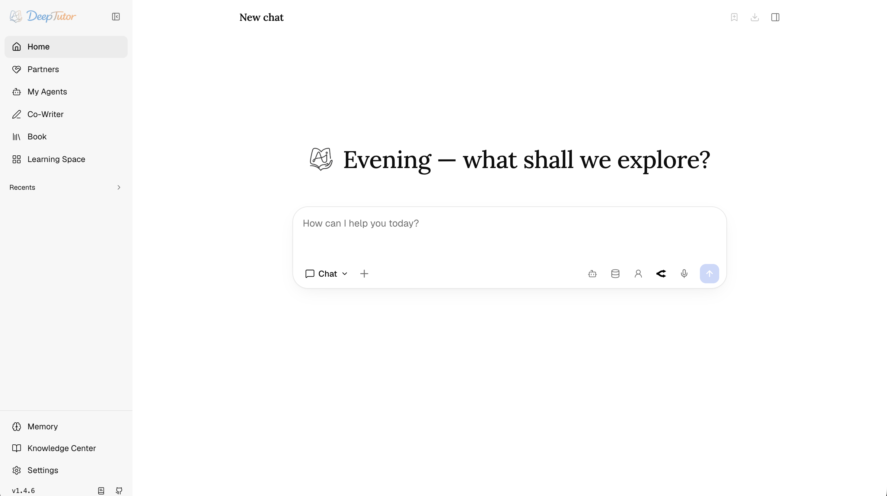
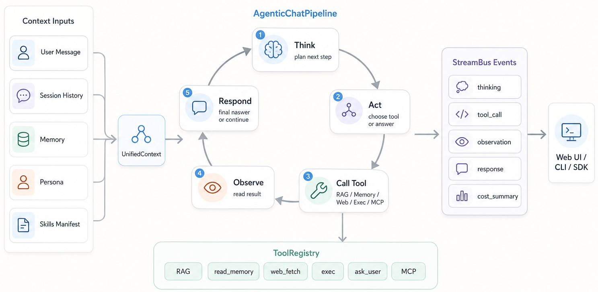
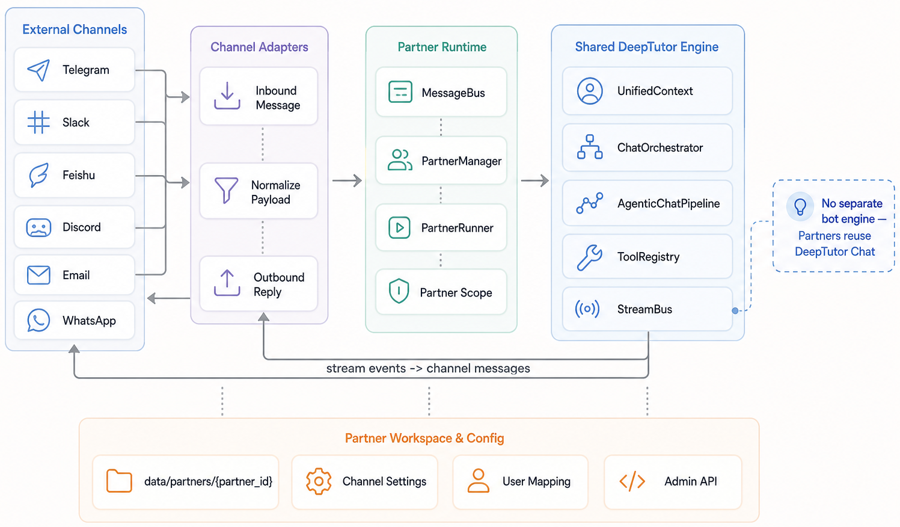
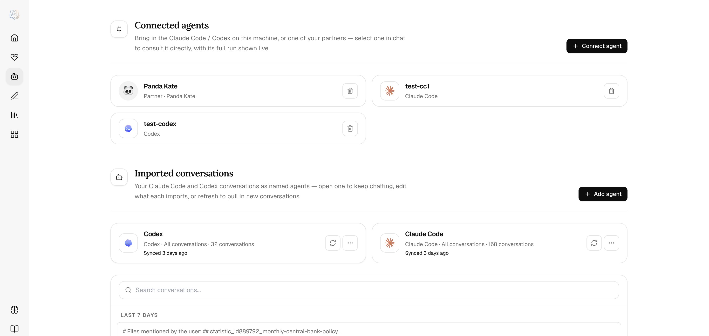
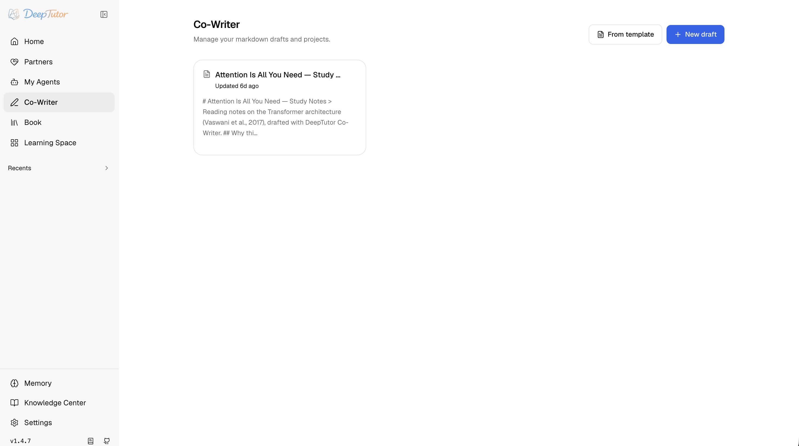
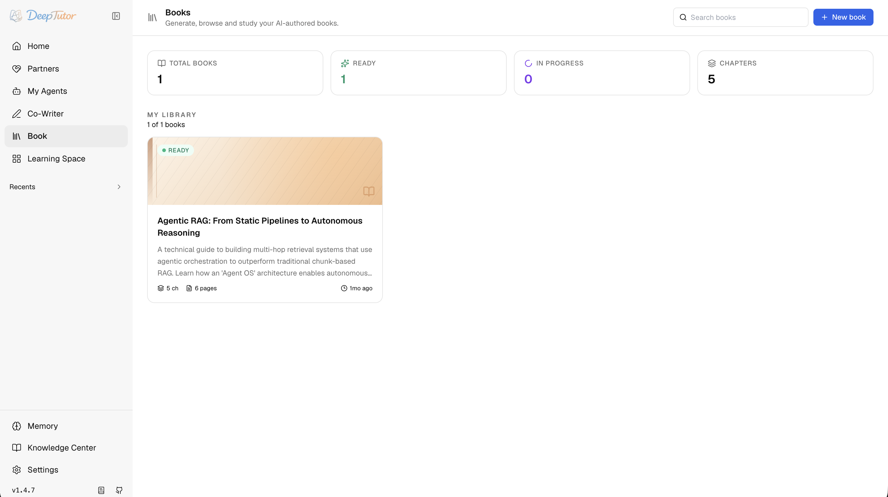
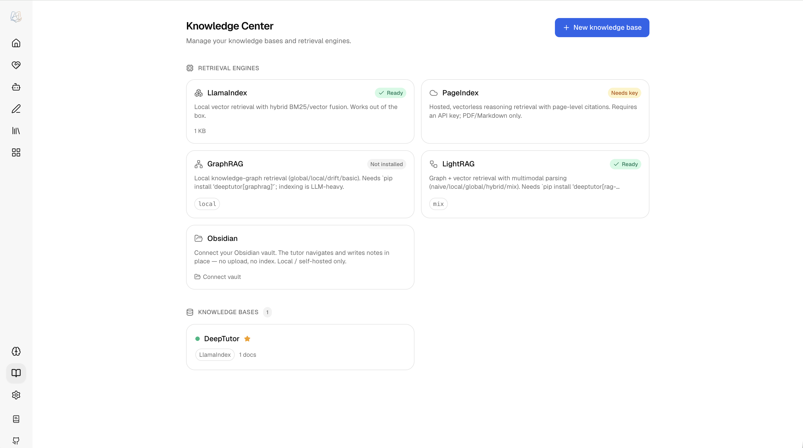
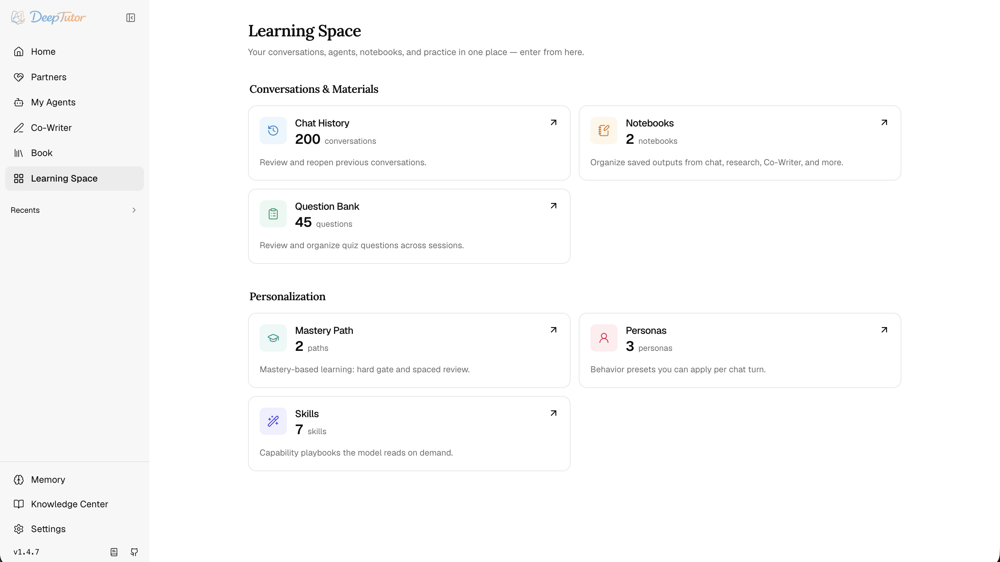
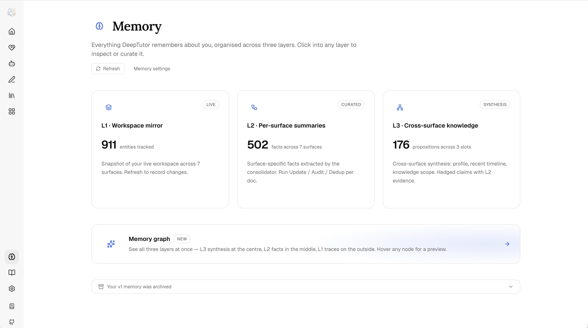

<div align="center">


# Cognivoy

Local vector/hybrid retrieval and Docling parsing are temporarily unavailable.
Keyword retrieval and saved knowledge-base data remain available; see
[current engine availability](OPTIONAL_CAPABILITIES.md#local-engine-availability).

### 个人智能学习伙伴

*Your agent-native learning journey.*

<p align="center">
  <a href="https://deeptutor.info" target="_blank"></a>
</p>

<p align="center">
  <a href="README.md"></a>
</p>

[](https://www.python.org/downloads/)
[](https://nextjs.org/)
[](LICENSE)
[](https://github.com/chenchunrun/Cognivoy/actions/workflows/tests.yml)
[](https://github.com/HKUDS/DeepTutor/releases)
[](https://arxiv.org/abs/2604.26962)

[Features](#-key-features) · [Get Started](#-get-started) · [Explore](#-explore-cognivoy) · [CLI](#%EF%B8%8F-cognivoy-cli--agent-native-interface) · [Ecosystem](#-ecosystem--eduhub--the-skills-community) · [Community](#-community)

</div>

---

> [!IMPORTANT]
> This repository is an independently maintained derivative of
> [HKUDS/DeepTutor](https://github.com/HKUDS/DeepTutor). It is not affiliated
> with, sponsored by, or endorsed by HKUDS, the Data Intelligence Lab, or The
> University of Hong Kong. Upstream names and links identify the origin of the
> work only.

Contributions to this derivative are described in the local
[Contributing Guide](CONTRIBUTING.md). Community expectations, support, and
security reporting are documented in [CODE_OF_CONDUCT.md](CODE_OF_CONDUCT.md),
[SUPPORT.md](SUPPORT.md), and [SECURITY.md](SECURITY.md).

### Upstream provenance

Cognivoy is derived from [HKUDS/DeepTutor](https://github.com/HKUDS/DeepTutor).
The upstream release history remains available on the
[DeepTutor releases page](https://github.com/HKUDS/DeepTutor/releases).
Stable upstream releases are reviewed selectively under the documented
[upstream tracking policy](UPSTREAM.md); they are not merged directly into the
Cognivoy release branch.

## ✨ Key Features

Cognivoy helps you turn a learning goal into a continuing practice: organize
materials in a learning project, work through a task with a tutor, check your
understanding, and return to the evidence and mistakes in later reviews.
It is designed for independent learners who want continuity beyond a single
answer, including exam preparation and learning from their own documents.

Our product principle is **understanding demonstrated through practice**.
Learning projects connect goals, tasks, structured teaching checkpoints and
review records. Answers should retain their sources; completion should reflect
learning evidence; reminders and agent actions should remain under user control.
These mechanisms support learning, but do not guarantee an exam result.

DeepTutor supplies the agent runtime and much of the tutoring/content foundation.
Cognivoy develops the project-based learning journey, execution governance and
its maintained Web experience.

Cognivoy is an agent-native learning workspace that connects tutoring, problem solving, quiz generation, research, visualization, and mastery practice in one extensible system.

- **One runtime for every mode** — Chat, Quiz, Research, Visualize, Solve, and Mastery Path run on the same agent loop, so you switch the objective, not the engine, and context moves with the learner.
- **Connected learning context** — Knowledge bases, books, Co-Writer drafts, notebooks, question banks, personas, and Memory stay available across every workflow instead of living in isolated tools.
- **Subagents and Partners** — consult a live coding CLI (Claude Code, Codex, Gemini, Kimi, opencode, or MiMo) or a Partner from any turn (or import their past conversations), and run persistent IM companions on the same brain.
- **Multi-engine knowledge** — versioned RAG libraries across LlamaIndex, PageIndex, GraphRAG, LightRAG, or a linked Obsidian vault, with pluggable document parsing.
- **Extensible tools and skills** — built-in tools, MCP servers, CLI apps, image / video / voice generation models, and installable community skills from EduHub.
- **Inspectable memory** — L1 traces, L2 surface summaries, and L3 synthesis make personalization visible and editable, with a Memory Graph that traces every claim back to its evidence.

Chat distinguishes exploration rounds from context tokens, with bounded adaptive
headroom and recoverable tool results.

---

## 🚀 Get Started

Cognivoy ships four installation paths. They all share one workspace layout: settings live in `data/user/settings/` under the directory you launch from (or under `COGNIVOY_HOME` / `cognivoy start --home` if you set one explicitly). For the full app, the recommended flow is **pick a workspace directory → install → `cognivoy init` → `cognivoy start`**.

<details>
<summary><b>Option 1 — Install From PyPI</b> · full local Web app + CLI, no clone required</summary>

> **Availability:** the independent Cognivoy package has not yet completed its
> first public PyPI release. Use the source installation below until a Cognivoy
> release appears on PyPI.

Full local Web app + CLI, no clone required. Needs **Python 3.11–3.13** and a **Node.js 20+** runtime on PATH (the packaged Next.js standalone server is spawned by `cognivoy start`).

```bash
mkdir -p my-cognivoy && cd my-cognivoy
pip install -U cognivoy
cognivoy init     # prompts for ports + LLM provider + optional embedding
cognivoy start    # starts backend + frontend; keep the terminal open
```

`cognivoy init` prompts for backend port (default `8001`), frontend port (default `3782`), LLM provider / base URL / API key / model, and an optional embedding provider for Knowledge Base / RAG.

After `cognivoy start`, open the frontend URL printed in the terminal — by default [http://127.0.0.1:3782](http://127.0.0.1:3782). Press `Ctrl+C` in that terminal to stop both backend and frontend. Skipping `cognivoy init` is fine for a quick trial; the app boots with default ports and empty model settings, configure them later in **Settings → Models**.

</details>

<details>
<summary><b>Option 2 — Install From Source</b> · develop against a checkout</summary>

For development against a checkout. Use **Python 3.11–3.13** and **Node.js 22 LTS** to match CI and Docker.

```bash
git clone https://github.com/chenchunrun/Cognivoy.git cognivoy
cd cognivoy

# Create a venv (macOS/Linux). Windows PowerShell:
#   py -3.11 -m venv .venv ; .\.venv\Scripts\Activate.ps1
python3 -m venv .venv && source .venv/bin/activate
python -m pip install --upgrade pip

# Install backend + frontend deps
python -m pip install -e .
( cd web && npm ci --legacy-peer-deps )

cognivoy init
cognivoy start --dev
```

`cognivoy start` builds the local `web/` frontend for production once and reuses it; `--dev` runs Next.js with HMR. Config layout, ports, and `Ctrl+C` match Option 1.

<details>
<summary><b>Conda environment</b> (instead of <code>venv</code>)</summary>

```bash
conda create -n cognivoy python=3.11
conda activate cognivoy
python -m pip install --upgrade pip
```

</details>

<details>
<summary><b>Optional install extras</b> — dev / partners / matrix / math-animator</summary>

```bash
pip install -e ".[dev]"             # tests/lint tools
# Local vector/hybrid retrieval and Docling are temporarily unavailable.
# Keyword retrieval is included; existing knowledge-base data is preserved.
pip install -e ".[partners]"        # Partner IM channel SDKs + MCP client
pip install -e ".[matrix]"          # Matrix channel without E2EE/libolm
pip install -e ".[matrix-e2e]"      # Matrix E2EE; requires libolm
pip install -e ".[math-animator]"   # Manim addon; requires LaTeX/ffmpeg/system libs
```

</details>

<details>
<summary><b>Frontend dependency tweaks & dev-server troubleshooting</b></summary>

**Changing frontend dependencies:** run `npm install --legacy-peer-deps` to refresh `web/package-lock.json`, then commit both `web/package.json` and `web/package-lock.json`.

**Stuck dev server:** if `cognivoy start --dev` reports an existing frontend that isn't responding, stop the PID it prints. If no Next.js process is actually running, the lock files are stale — remove them and retry:

```bash
rm -f web/.next/dev/lock web/.next/lock
cognivoy start --dev
```

</details>

</details>

<details>
<summary><b>Option 3 — Docker</b> · one self-contained container</summary>

One container for the full Web app. The following GitHub Container Registry
images become available after the first public Cognivoy release:

- `ghcr.io/chenchunrun/cognivoy:latest` — stable release
- `ghcr.io/chenchunrun/cognivoy:pre` — pre-release, when available

> See [CONTAINERIZATION.md](./CONTAINERIZATION.md) for podman/rootless/read-only-rootfs deployments and the full per-installation guide.

```bash
docker run --rm --name cognivoy \
  -p 127.0.0.1:3782:3782 \
  -v cognivoy-data:/app/data \
  ghcr.io/chenchunrun/cognivoy:latest
```

> **Only `3782` needs to be published.** The browser talks exclusively to the frontend origin; the Next.js middleware (`web/proxy.ts`) forwards `/api/*` and `/ws/*` to the FastAPI backend **inside the container**. Publishing `8001` (`-p 127.0.0.1:8001:8001`) is optional — handy only for hitting the API directly with curl or scripts.

Open [http://127.0.0.1:3782](http://127.0.0.1:3782). The container creates `/app/data/user/settings/*.json` on first boot; configure model providers from the Web Settings page. Config, API keys, logs, workspace files, memory, and knowledge bases persist in the `cognivoy-data` volume.

- **Different host ports:** change the left side of each `-p host:container` mapping (e.g. `-p 127.0.0.1:8088:3782`). If you change container-side ports in `/app/data/user/settings/system.json`, restart and update the right side of each mapping to match.
- **Detached:** add `-d`, then `docker logs -f cognivoy` to follow, `docker stop cognivoy` to stop, `docker rm cognivoy` before reusing the name. The `cognivoy-data` volume keeps your settings and workspace across restarts.

**Remote Docker / reverse proxy:** the browser only talks to the frontend
origin (`:3782`); the in-container Next.js middleware forwards `/api/*` and
`/ws/*` to the backend server-side. For the common single-container case you
don't configure an API base at all — just point your reverse proxy / TLS
terminator at `:3782`. You only need an API base for a **split deployment**
(backend in a separate container/host): set `next_public_api_base` in
`data/user/settings/system.json` to the in-network address the frontend server
uses to reach the backend (it's read server-side, never sent to the browser).

```json
{
  "next_public_api_base": "http://backend:8001"
}
```

`next_public_api_base_external` (and its alias `public_api_base`) are accepted as
lower-precedence fallbacks. CORS uses frontend **origins**, not API URLs. With
auth disabled, Cognivoy permits normal HTTP/HTTPS browser origins by default.
With auth enabled, add exact frontend origins:

```json
{
  "cors_origins": ["https://cognivoy.example.com"]
}
```

<details>
<summary><b>Connecting to Ollama / LM Studio / llama.cpp / vLLM / Lemonade on the host</b></summary>

Inside Docker, `localhost` is the container itself, not your host machine. To reach a model service running on the host, use the host gateway (recommended):

```bash
docker run --rm --name cognivoy \
  -p 127.0.0.1:3782:3782 -p 127.0.0.1:8001:8001 \
  --add-host=host.docker.internal:host-gateway \
  -v cognivoy-data:/app/data \
  ghcr.io/chenchunrun/cognivoy:latest
```

Then in **Settings → Models**, point the provider Base URL at `host.docker.internal`:

- Ollama LLM: `http://host.docker.internal:11434/v1`
- Ollama embedding: `http://host.docker.internal:11434/api/embed`
- LM Studio: `http://host.docker.internal:1234/v1`
- llama.cpp: `http://host.docker.internal:8080/v1`
- Lemonade: `http://host.docker.internal:13305/api/v1`

Docker Desktop (macOS/Windows) usually resolves `host.docker.internal` without `--add-host`. On Linux, the flag is the portable way to create that hostname on modern Docker Engine.

**Linux alternative — host networking:** add `--network=host` and drop the `-p` flags. The container shares the host network directly, so open [http://127.0.0.1:3782](http://127.0.0.1:3782) (or the `frontend_port` in `system.json`), and host services can be reached with normal localhost URLs like `http://127.0.0.1:11434/v1`. Note that host networking exposes container ports directly on the host and may conflict with existing services — to keep them on loopback, set `BACKEND_HOST=127.0.0.1` and `FRONTEND_HOST=127.0.0.1` (see [CONTAINERIZATION.md](./CONTAINERIZATION.md)).

</details>

</details>

<details>
<summary><b>Option 4 — CLI Only</b> · no Web UI, from a source checkout</summary>

When you don't need the Web UI. The CLI-only package is installed from a source checkout, not from PyPI.

```bash
git clone https://github.com/chenchunrun/Cognivoy.git
cd cognivoy

# Create a venv (macOS/Linux). Windows PowerShell:
#   py -3.11 -m venv .venv-cli ; .\.venv-cli\Scripts\Activate.ps1
python3 -m venv .venv-cli && source .venv-cli/bin/activate
python -m pip install --upgrade pip

python -m pip install -e ./packaging/cognivoy-cli
cognivoy init --cli
cognivoy chat
```

`cognivoy init --cli` shares the same `data/user/settings/` layout as the full app but skips the backend/frontend port prompts and defaults embeddings to **off** (choose `Yes` for vector/hybrid retrieval; [keyword retrieval](MODEL_FREE_RETRIEVAL.md) needs no embedding profile). It still writes a complete runtime layout (`system.json`, `auth.json`, `integrations.json`, `model_catalog.json`, `main.yaml`, `agents.yaml`) and still prompts for the active LLM provider and model.

<details>
<summary><b>Common commands</b></summary>

```bash
cognivoy chat                                          # interactive REPL
cognivoy chat --capability deep_solve --tool rag --kb my-kb
cognivoy run chat "Explain Fourier transform"
cognivoy run deep_solve "Solve x^2 = 4" --tool rag --kb my-kb
cognivoy kb create my-kb --doc textbook.pdf
cognivoy memory show
cognivoy config show
```

</details>

The local `cognivoy-cli` install ships no Web assets or server dependencies. Keep the source checkout around — the editable install points to it. To add the Web app later, install the PyPI package (Option 1) and run `cognivoy init` + `cognivoy start` from the same workspace.

</details>

<details>
<summary><b>Code Execution Sandbox (office skills)</b> · running model-generated code for docx / pdf / pptx / xlsx</summary>

The built-in office skills — **docx / pdf / pptx / xlsx** — work by having the
model write a short Python script (`python-docx`, `reportlab`, `openpyxl`, …),
run it through the `exec` / `code_execution` tools, and hand back a download URL.
Those tools mount only when a backend provides OS-enforced isolation for the
current task directory:

- **Linux with bubblewrap:** each task receives a separate mount namespace and
  network namespace, so code execution can be enabled.
- **Restricted subprocess and the legacy shared-workspace runner:** rejected by
  default because they cannot prevent one task from reading another task's
  files. The runner endpoint is additionally bearer-authenticated and placed on
  an internal Docker network.

`sandbox_allow_subprocess` remains a compatibility setting, but does not bypass
the per-task isolation requirement. If no qualifying backend is available,
`exec` and `code_execution` stay disabled and Office skills cannot generate files.

</details>

<details>
<summary><b>Configuration reference</b> — config files under <code>data/user/settings/</code> (JSON/YAML)</summary>

Everything under `data/user/settings/` is plain JSON/YAML. The **Settings** page in the browser is the recommended editor.

| File | Purpose |
|:---|:---|
| `model_catalog.json` | LLM, embedding, and search provider profiles; API keys; active models |
| `llamaindex.json` | Knowledge retrieval profile and text-chunk settings |
| `system.json` | Backend/frontend ports, public API base, CORS, SSL verification, attachment directory and upload/extraction limits |
| `auth.json` | Optional auth toggle, username, password hash, token/cookie settings |
| `integrations.json` | Optional PocketBase and sidecar integration settings |
| `interface.json` | UI and model output language / theme / sidebar preferences |
| `main.yaml` | Runtime behavior defaults and path injection |
| `agents.yaml` | Capability/tool temperature and token settings |

Project-root `.env` is **not** read as an application config file. For a minimal model setup, open **Settings → Models**, add an LLM profile (Base URL / API key / model name), and save. LlamaIndex knowledge retrieval defaults to model-free **keyword** mode for new installations; add an embedding profile only for vector/hybrid retrieval. Existing saved vector/hybrid choices remain unchanged. See [model-free knowledge retrieval](MODEL_FREE_RETRIEVAL.md) for configuration, migration, and matching limits, and [optional capabilities](OPTIONAL_CAPABILITIES.md) for animation/media deployment requirements.

</details>

## 📖 Explore Cognivoy

Start with the main surfaces you will use day to day: Chat, Partners, My Agents, Co-Writer, Book, Knowledge Center, Learning Space, Memory, and Settings. The tour then covers Multi-User deployments for shared, isolated workspaces.

<div align="center">

</div>

<details>
<summary><b>🏗️ System architecture</b></summary>

<div align="center">

</div>

</details>

<details>
<summary><b>💬 Chat — The Agent Loop You Actually Use</b></summary>

Chat is the default capability and where most work begins. A single thread can talk normally, call tools, ground itself in selected knowledge bases, read attachments, generate images, consult subagents, write notebook records, and continue with the same context across turns.

<div align="center">

</div>

The loop is deliberately simple: the model thinks in rounds, calls tools when useful, observes the results, and finishes with a tool-free message. `ask_user` is special — instead of guessing, the agent can pause the turn, ask a structured clarifying question, and resume once you answer.

<div align="center">

</div>

User-toggleable tools are `brainstorm`, `web_search`, `paper_search`, `reason`, and `geogebra_analysis` — plus `imagegen` and `videogen` once you configure the matching generation model. Contextual tools such as `rag`, `kb_files`, `read_source`, `read_memory`, `write_memory`, `read_skill`, `load_tools`, `exec`, `web_fetch`, `ask_user`, `list_notebook`, `write_note`, `github`, and `consult_subagent` mount automatically when the turn has the right context.

Context comes in two kinds: **sticky session context** (subagent, knowledge bases, persona, model, voice) lives on the composer toolbar and persists across turns; **one-time references** (files, chat history, books, notebooks, question bank, imported agents) come from the `+` menu for a single turn.

Chat is also the launch point for deeper capabilities: **Quiz** for question generation, **Research** for cited reports, **Visualize** for charts / diagrams / animations, and — under *More Capabilities* — **Solve** for worked reasoning and **Mastery Path** for learning-plan flows.

</details>

<details>
<summary><b>🤝 Partner — Persistent Companions on the Same Brain</b></summary>

<div align="center">

</div>

Partners are persistent companions with their own soul, model policy, library, memory, and channels. They are not a separate bot engine: every inbound web or IM message becomes a normal `ChatOrchestrator` turn inside a partner-scoped workspace. A partner is "a chat that has a personality and a phone number."

<div align="center">

</div>

Each partner has a `SOUL.md`, model selection, channels, tool policy, and assigned library. Knowledge bases, skills, and notebooks are copied into `data/partners/<id>/workspace/`, so the same RAG, skill, notebook, and memory tools work without special cases. A partner reads its owner's memory but writes only its own.

<div align="center">

</div>

The channel layer is schema-driven and can connect to IM platforms such as Feishu, Telegram, Slack, Discord, DingTalk, QQ/NapCat, WeCom, WhatsApp, Zulip, Mattermost, Matrix, Mochat, and Microsoft Teams depending on installed extras and configured credentials. A partner can also be connected as a subagent and consulted from a normal chat turn — see **My Agents** below.

</details>

<details>
<summary><b>🧑‍🚀 My Agents — Consult & Import Other Agents</b></summary>

<div align="center">

</div>

My Agents turns other agents into context for Cognivoy, and does two distinct things. **Connect a live agent** — a Claude Code, Codex, Gemini, Kimi, opencode, or MiMo Code CLI on your machine, or one of your Partners — and consult it from inside a chat turn: Cognivoy actually *runs* the other agent and streams its work into the Activity panel via the `consult_subagent` tool. Select it with the Agent chip (or type `@`), and set how many rounds the consult may take.

<div align="center">

</div>

**Import past conversations** — bring in your existing Claude Code and Codex history as named, searchable, resumable agents. Pick which days to import; refreshing re-syncs them. Reference an imported conversation from any chat turn via `+` → My Agents, and Cognivoy reads it as a third-party transcript — it stays *their* conversation, not Cognivoy's own voice.

</details>

<details>
<summary><b>✍️ Co-Writer — Selection-Aware Markdown Drafting</b></summary>

<div align="center">

</div>

Co-Writer is a split-view Markdown workspace for reports, tutorials, notes, and long-form learning artifacts. Documents autosave and render a live preview (KaTeX math, diagram fences), and can be saved back into notebooks when a draft becomes reusable context.

<div align="center">

</div>

Its defining idea is **surgical editing**: select a span and ask Cognivoy to rewrite, expand, or shorten it. The edit agent can ground the change in a knowledge base or web evidence, keeps a trace of its tool calls, and shows every change as an accept/reject diff — so nothing lands until you approve it.

</details>

<details>
<summary><b>📖 Book — Living Books from Your Materials</b></summary>

<div align="center">

</div>

Book turns selected sources into an interactive **living book** — not a static PDF, but a reading environment built from typed blocks. A book can start from knowledge bases, notebooks, question banks, or chat history; the creation flow proposes a chapter outline before content is generated, so you review the shape instead of accepting a blind one-shot output.

<p align="center">

&nbsp;

&nbsp;

</p>

Each chapter compiles into typed blocks — text, callouts, quizzes, flash cards, timelines, code, figures, interactive HTML, animations, concept graphs, deep dives, and user notes — and every page has its own Page Chat. Blocks are editable: insert, move, regenerate, or switch a block's type without rewriting the chapter. Maintenance commands such as `cognivoy book health` and `cognivoy book refresh-fingerprints` help detect when source knowledge has drifted from compiled pages.

</details>

<details>
<summary><b>📚 Knowledge Center — Multi-Engine RAG Libraries</b></summary>

<div align="center">

</div>

Knowledge bases are the document collections behind RAG — they ground Chat turns, Co-Writer edits, Book generation, and Partner conversations. What's distinctive is a **choice of retrieval engines**: **LlamaIndex** (the default engine, with model-free BM25 and optional vector/hybrid retrieval), **PageIndex** (hosted, reasoning retrieval with page-level citations), **GraphRAG** and **LightRAG** (knowledge-graph retrieval), **LightRAG Server** (retrieval offloaded to an external LightRAG instance you connect over HTTP), **Tencent IMA** (a library you curate in IMA, searched over its OpenAPI), or a linked **Obsidian** vault the tutor reads and writes in place. Each KB is bound to one engine.

For the recommended lightweight setup, choose **Settings → Embedding → Knowledge retrieval mode → Keyword (no model)**. [Keyword/BM25 retrieval](MODEL_FREE_RETRIEVAL.md) reuses extracted text without Ollama, embedding API calls, or a GPU. It does not promise cross-language semantic matching; scanned images still need text extraction.

<div align="center">

</div>

Creating a KB, you either **create new** (upload documents and build a fresh index) or **link existing** (reuse an index built elsewhere, read in place with no re-index). Vector/hybrid re-indexing writes a new flat `version-N` directory and keeps prior ones; keyword indexing publishes its separate text sidecar atomically. A single document can be removed even from an **error**-state base — dropping a file that failed to parse without a full delete-and-rebuild. Document parsing — Text-only, MinerU, Docling, markitdown, or PyMuPDF4LLM — is chosen in **Settings → Knowledge Base**, with local model downloads off by default. The CLI mirrors the lifecycle with `cognivoy kb list`, `info`, `create`, `add`, `search`, `set-default`, and `delete`.

</details>

<details>
<summary><b>🌐 Learning Space — Skills, Personas, and Reusable Context</b></summary>

<div align="center">

</div>

Learning Space is the library and personalization layer — where the things that persist live. **Conversations & Materials** holds your chat history, notebooks, and a question bank (each saved question keeps your answer, the reference answer, and an explanation). **Personalization** holds mastery paths, personas (behavior presets such as *peer*, *research-assistant*, *teacher*), skills (`SKILL.md` playbooks the model reads on demand), **MCP Services** — a curated store of hosted MCP servers you install for yourself in one click, plus any remote server you configure by URL — and **CLI Apps**, command-line tools from the [CLI-Anything](https://github.com/HKUDS/CLI-Anything) catalog that the chat agent calls directly, with each app's own usage guide loaded on demand. Everything here can be reused from Chat, Partners, Co-Writer, and Book.

<div align="center">

</div>

You don't have to write every skill yourself — **Import from EduHub** browses the community catalog and downloads a skill straight into your library through a security gate (see [Ecosystem](#-ecosystem--eduhub--the-skills-community)).

</details>

<details>
<summary><b>🧠 Memory — Inspectable Personalization</b></summary>

<div align="center">

</div>

Memory is a file-backed, three-layer system you can read, curate, and audit — deliberately *not* a hidden vector store. **L1** is the workspace mirror plus an append-only event trace (`trace/<surface>/<date>.jsonl`); **L2** is per-surface curated facts (`L2/<surface>.md`); **L3** is cross-surface synthesis (`L3/<profile|recent|scope|preferences>.md`). Because L2 cites L1 and L3 cites L2, nothing in your profile is unaccountable.

<div align="center">

</div>

The Memory Graph shows the whole pyramid — L3 synthesis at the centre, L2 in the middle ring, L1 traces on the outside — so you can trace any synthesized claim back to the exact raw event behind it. Memory is tracked across `chat`, `notebook`, `quiz`, `kb`, `book`, partner, and `cowriter` surfaces; the consolidator's Update / Audit / Dedup budgets are tuned in **Settings → Memory**.

</details>

<details>
<summary><b>⚙️ Settings — One Control Plane</b></summary>

<div align="center">

</div>

Settings is the operational control plane, with a live status strip (backend health and resident memory across the process tree) and one card per area: **Appearance** (theme, interface and model output language, code-block styling), **Network** (API base, ports, CORS), **Models** (LLM, Embedding, Search, Text-to-Speech, Speech-to-Text, Image Generation, Video Generation), **Knowledge Base** (document parsing engine), **Chat** (tools, per-capability parameters, attachment caps), **Partners & Agents** (the subagents you can consult from a turn), and **Memory** (the consolidator's budgets).

<div align="center">

</div>

Most sections use a draft-and-apply flow, so you can test a provider before committing it. Four themes ship in the box — Default, Cream, Dark, and Glass. Project-root `.env` files are intentionally ignored; runtime configuration lives under `data/user/settings/*.json` unless `COGNIVOY_HOME` or `cognivoy start --home` points the app elsewhere.

**OpenAI Codex OAuth (experimental).** Picking **OpenAI Codex** under Models → LLM replaces the API-key fields with a browser sign-in that runs against your own ChatGPT plan, so no `OPENAI_API_KEY` is needed. Tokens live only in `data/system/user-secrets/<owner>/private/openai-codex/` — in the multi-container Compose deployment, outside every tree the exec sandbox can reach — and Cognivoy never reads or modifies your `~/.codex` CLI login. The model list comes from that account's live catalog; signing in publishes the profile but only becomes the active model when no LLM is configured yet. Because a token authorizes one person's plan, the profile is not shareable through user grants — each account signs in for itself, ordinary users included: their card sits under Models → LLM, and the resulting models, catalog, and sign-out stay private to that account.

Default local Docker and Podman deployments use separate loopback networks and need a temporary bridge during sign-in. Follow the [temporary local Codex OAuth bridge guide](./CONTAINERIZATION.md#temporary-local-codex-oauth-bridge) for the exact Docker, Compose, Podman, and teardown commands.

For a remote deployment, the browser's `localhost` and the server's `localhost` are different machines, so an ordinary reverse proxy alone cannot carry the browser's localhost callback to the server. Use an SSH tunnel as the callback bridge. The tunnel reaches the already-published Web port; Next.js rewrites only the exact callback path to the public callback broker, and the broker validates `state` before routing to the original OAuth operation. The callback listener remains on the backend loopback, ports `1455` and `1457` are not published, and this path supports the default Docker bridge network.

```bash
ssh -N -L 1455:127.0.0.1:3782 <ssh-user>@<server-host>
```

If Cognivoy reports fallback callback port `1457`, use:

```bash
ssh -N -L 1457:127.0.0.1:3782 <ssh-user>@<server-host>
```

Run only the one command that matches the actual callback port; never run both. `3782` is only the example Web port: it is the configured frontend/container port reported as `callback_forward_port`. That value does not guarantee that the same port is listening on the SSH host's `127.0.0.1`. If Docker or Podman publishes a different host port, or a reverse proxy listens on a different port, replace only the right-hand target port (`3782` above) with the Web port actually listening on the SSH host's `127.0.0.1`; keep the left-hand callback port as `1455` or `1457`. `<server-host>` is the SSH host whose loopback owns that listening port. If the browser URL names a reverse proxy or load balancer, replace it with the correct SSH frontend host.

The CLI prints the tunnel command and then immediately tries to open the browser. On a remote deployment, keep the authorization page open without completing it, establish the printed tunnel in another terminal, and only then continue authorization.

Remote-topology detection has a localhost boundary. If Web itself is reached through an SSH or IDE localhost forward, the browser cannot tell that the server is remote. For the current Web operation, leave its authorization page unfinished, read `redirect_uri` in that operation's authorize URL to identify callback port `1455` or `1457`, and create the second tunnel from that local port to the actual Web port. Alternatively, cancel that Web operation and start a new one with the CLI; the CLI output belongs to the new operation and must not be used for the existing Web operation. Quota errors and catalog failures are reported as-is and never fall back to a paid provider. This compatibility path is experimental: the upstream interface may change.

</details>

<details>
<summary><b>👥 Multi-User — Shared Deployments</b> · optional auth, isolated per-user workspaces</summary>

Authentication is **off by default** — Cognivoy runs single-user. Turn it on and one `data/` tree hosts an admin workspace, isolated per-user workspaces, and partner workspaces side by side:

```text
data/
├── user/                    # Admin workspace + global settings
├── users/<uid>/             # Per-user scope: chat history, memory, notebooks, KBs
├── partners/<id>/workspace/ # Partner (synthetic-user) scope
├── cli-apps/                # Installed CLI apps, mounted read-only into the sandbox
└── system/                  # auth · grants · audit · user-secrets/<owner> (OAuth tokens)
```

The **first registered user becomes admin** and owns model catalogs, provider credentials, shared knowledge bases, skills, and per-user grants. Everyone else gets an isolated workspace and a redacted Settings page — admin-assigned models, KBs, and skills show up as scoped, read-only options, never as raw API keys.

**Enable it:** turn auth on in `data/user/settings/auth.json`, restart `cognivoy start`, register the first admin at `/register`, then add users from `/admin/users` and assign models, KBs, skills, partners, tool/MCP/CLI-app policy, and code-execution access through grants.

> PocketBase stays a single-user integration — keep `integrations.pocketbase_url` blank for multi-user deployments unless you've wired up an external user store.

</details>

## ⌨️ Cognivoy CLI — Agent-Native Interface

One `cognivoy` binary, two ways in: an interactive **REPL** for people who live in the terminal, and structured **JSON** for other agents that drive Cognivoy as a tool. Same capabilities, tools, and knowledge bases either way.

<details>
<summary><b>Drive it yourself</b></summary>

`cognivoy chat` opens an interactive REPL; `cognivoy run <capability> "<message>"` fires a single turn and exits. Both speak the same `--capability`, `--tool`, `--kb`, and `--config` flags.

```bash
cognivoy chat                                              # interactive REPL
cognivoy chat --capability deep_solve --kb my-kb --tool rag
cognivoy run chat "Explain the Fourier transform" --tool rag --kb textbook
cognivoy run deep_research "Survey 2026 papers on RAG" \
  --config mode=report --config depth=standard
```

Everything the Web app does is here too — knowledge bases (`kb`), sessions (`session`), partners (`partner`), skills (`skill`), notebooks, memory, and config. Full list below.

</details>

<details>
<summary><b>Let an agent drive it</b></summary>

Cognivoy is built to be *operated by another agent*. Add `--format json` to any `run` and each turn streams **NDJSON — one event per line** (`content`, `tool_call`, `tool_result`, `done`, …), every line tagged with its `session_id`. Runs are headless-safe: an `ask_user` pause with no TTY auto-resolves with an empty reply instead of hanging.

```bash
# One shot, machine-readable
cognivoy run deep_solve "Find d/dx[sin(x^2)]" --tool reason --format json

# Chain turns in one stateful session — capture the id, reuse it
SID=$(cognivoy run deep_research "Survey 2026 papers on RAG" \
  --config mode=report --config depth=standard --format json \
  | jq -r 'select(.type=="done").session_id')
cognivoy run deep_question "Quiz me on that survey" --session "$SID" --format json
```

</details>

<details>
<summary><b>Command reference</b></summary>

| Command | Description |
|:---|:---|
| `cognivoy init` | Create or update `data/user/settings` for the current workspace |
| `cognivoy start [--home PATH] [--dev]` | Launch backend + frontend together; `--dev` enables frontend HMR |
| `cognivoy serve [--port PORT]` | Start only the FastAPI backend |
| `cognivoy run <capability> <message>` | Run a single capability turn (`chat`, `deep_solve`, `deep_question`, `deep_research`, `visualize`, `math_animator`, `mastery_path`); add `--format json` for NDJSON output |
| `cognivoy chat` | Interactive REPL with capability, tool, KB, notebook, and history controls |
| `cognivoy partner list/create/start/stop` | Manage IM-connected partners |
| `cognivoy kb list/info/create/add/search/set-default/delete` | Manage LlamaIndex knowledge bases |
| `cognivoy skill search/install/list/remove/login/logout/publish/update` | Manage skills, install from hubs, and publish your own (`eduhub:<slug>` by default, see Ecosystem) |
| `cognivoy memory show/clear` | Inspect L2/L3 memory docs or clear L1/all memory |
| `cognivoy session list/show/open/rename/delete` | Manage shared sessions |
| `cognivoy notebook list/create/show/add-md/replace-md/remove-record` | Manage notebooks from Markdown files |
| `cognivoy book list/health/refresh-fingerprints` | Inspect books and refresh source fingerprints |
| `cognivoy plugin list/info` | Inspect registered tools and capabilities |
| `cognivoy config show` | Print configuration summary |
| `cognivoy provider login <provider>` | Provider auth (`openai-codex` OAuth login; `github-copilot` validates an existing Copilot auth session) |

</details>

<details>
<summary><b>CLI-only distribution</b></summary>

The CLI-only package lives in `packaging/cognivoy-cli`. In this checkout, install it from source:

```bash
python -m pip install -e ./packaging/cognivoy-cli
```

It isn't published to PyPI yet, so the main [Get Started](#-get-started) section keeps the source-install path.

</details>

## 🧩 Ecosystem — EduHub & the Skills Community

Cognivoy skills use the open **Agent-Skills** format — a folder with a `SKILL.md` playbook (YAML frontmatter + Markdown) and optional reference files. Nothing about it is Cognivoy-specific, so any registry that speaks the format becomes a source for your library. Cognivoy ships with the upstream **[EduHub](https://eduhub.deeptutor.info/)** education-focused skill registry wired in as the default hub. EduHub is operated by the DeepTutor ecosystem, not by this independent distribution.

<details>
<summary><b>EduHub — upstream skill ecosystem</b></summary>

[**EduHub**](https://eduhub.deeptutor.info/) is an upstream community hub for sharing teaching-oriented agent skills — Socratic tutors, flashcard builders, essay feedback, exam blueprints, concept explainers, and more. Cognivoy includes a compatible client, so a bare slug or an `eduhub:` prefix resolves to it without additional configuration.

**Find and install** — in the browser, open **Learning Space → Skills → Import from EduHub** to browse the catalog and download a skill straight into your library. From the terminal:

```bash
cognivoy skill search "socratic tutor"               # search EduHub (the default hub)
cognivoy skill install socratic-tutor                # fetch → verify → register
cognivoy skill install eduhub:socratic-tutor@1.2.0   # pin a hub and a version
cognivoy skill list                                  # local skills with their hub provenance
```

**Publish your own** — package a `SKILL.md` and share it back to the community:

```bash
cognivoy skill login                                 # browser sign-in to EduHub
cognivoy skill publish ./my-skill                    # interactive: pick a track + tags, then upload
cognivoy skill update                                # roll back or release a new version
```

EduHub is also a standalone, ClawHub-compatible registry, so agents that aren't Cognivoy (Claude Code, Codex, …) can use it directly through the `eduhub` CLI — `npx eduhub install socratic-tutor`.

</details>

<details>
<summary><b>The import safety gate</b></summary>

Whatever the source, every import passes the **same safety gate** before anything touches your workspace:

- the registry's **security verdict** is checked first — flagged packages are refused unless you pass `--allow-unverified`;
- archives are extracted defensively (zip-slip / zip-bomb guards) behind a text/script **suffix whitelist**, so binaries never land in the workspace;
- frontmatter is normalized to Cognivoy's schema and `always:` is **stripped**, so a downloaded skill can never force itself into every system prompt;
- provenance — hub, version, verdict, and install time — is written to `.hub-lock.json` for audits and updates.

In multi-user deployments, installing is admin-only: a new skill lands in the admin catalog and stays invisible to other users until a grant assigns it, so an admin can vet it before rolling it out.

</details>

<details>
<summary><b>Also compatible with ClawHub</b></summary>

Because Cognivoy speaks the open Agent-Skills format, **[ClawHub](https://clawhub.ai/)** works as a first-class source too — it's built in alongside EduHub. Pick it with the hub prefix:

```bash
cognivoy skill search "git release notes" --hub clawhub
cognivoy skill install clawhub:git-release-notes@1.0.1
```

Add more registries in `settings/skill_hubs.json`: a `type: "clawhub"` entry points at any compatible HTTP API (EduHub and ClawHub both speak it), `type: "command"` wraps whatever fetch CLI a registry ships, and `"default"` chooses the hub used for bare slugs. All of them feed the same import gate.

</details>

## 🌐 Community

### 📮 Contact

This repository is independently maintained. Use this repository's own GitHub
Issues for support and contribution discussions. For the original DeepTutor
project and its official community, visit
[HKUDS/DeepTutor](https://github.com/HKUDS/DeepTutor).

### 🙏 Appreciation

The original DeepTutor project credits [**Chao Huang**](https://sites.google.com/view/chaoh),
the Data Intelligence Lab at HKU, and its contributors, including
[**Jiahao Zhang**](https://github.com/zzhtx258),
[**Zirui Guo**](https://github.com/LarFii), and
[**Xubin Ren**](https://github.com/Re-bin). Those upstream credits are retained
for attribution and do not imply endorsement of this derivative.

Cognivoy also stands on the shoulders of outstanding open-source projects that gave us both tools and inspiration:

| Project | Role / Inspiration |
|:---|:---|
| [**LlamaIndex**](https://github.com/run-llama/llama_index) | RAG pipeline and document-indexing backbone |
| [**nanobot**](https://github.com/HKUDS/nanobot) | Ultra-lightweight agent engine that powered the original TutorBot *(HKUDS)* |
| [**LightRAG**](https://github.com/HKUDS/LightRAG) | Simple & fast RAG *(HKUDS)* |
| [**AutoAgent**](https://github.com/HKUDS/AutoAgent) | Zero-code agent framework *(HKUDS)* |
| [**AI-Researcher**](https://github.com/HKUDS/AI-Researcher) | Automated research pipeline *(HKUDS)* |
| [**OpenClaw**](https://github.com/openclaw/openclaw) | Open agent gateway and skill ecosystem behind ClawHub |
| [**Codex**](https://github.com/openai/codex) | Agent-native coding CLI that inspired our CLI workflow |
| [**Claude Code**](https://github.com/anthropics/claude-code) | Agentic coding CLI that inspired the Cognivoy agent loop |
| [**ManimCat**](https://github.com/Wing900/ManimCat) | AI-driven math animation generation for Math Animator |

### 🗺️ Roadmap & Contribute

Roadmap proposals for this derivative should be opened in this repository. For
the upstream roadmap, visit
[HKUDS/DeepTutor issues](https://github.com/HKUDS/DeepTutor/issues/498). If
you'd like to contribute here, see the [**Contributing Guide**](CONTRIBUTING.md).
Release-to-release changes are recorded in the Cognivoy
[**Changelog**](CHANGELOG.md).

**Current Web scope:** external MCP servers can be connected, authorized, and
managed in **Learning Space → MCP Services**. Mastery paths are created in Chat:
attach a knowledge base in the composer, choose **Mastery Path**, and ask the
tutor to build the path. A separate knowledge-base import wizard is not part of
the current Web workflow.

## License and attribution

This independent derivative distribution is licensed under the
[Apache License 2.0](LICENSE).

The project is based on an upstream open-source work originally developed by
the Data Intelligence Lab at The University of Hong Kong. Copyright in the
original work remains with its original owner and contributors. Copyright in
the derivative modifications and additions made from 2026 onward belongs to
their respective contributors. See [NOTICE](NOTICE) for the complete attribution,
upstream identity, and modification notice. A summary of derivative changes is
maintained in [MODIFICATIONS.md](MODIFICATIONS.md).

Third-party libraries and assets remain subject to their respective licenses.
The audited visual-asset sources and privacy review are recorded in
[ASSET_PROVENANCE.md](ASSET_PROVENANCE.md).
The names and marks of upstream projects and providers belong to their
respective owners; the Apache License does not grant trademark rights.
